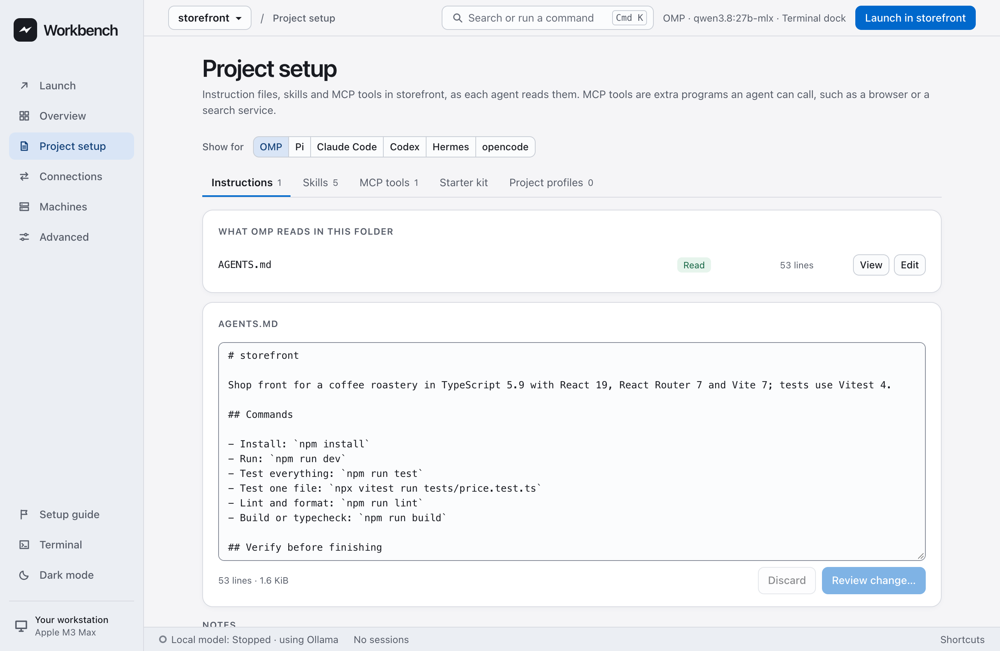

# Project setup

This guide covers what an agent reads from your project folder (instruction files, skills and MCP servers), how Agent Workbench shows and writes those files, the consent step for folders that start programs, the starter kits, and what Workbench remembers for each folder.

<picture>
<source media="(prefers-color-scheme: dark)" srcset="images/project-setup-dark.png">

</picture>

Open **Project setup** in the sidebar. **Show for** picks the agent whose view you see; each agent reads a folder differently, and the page shows what that agent will read, not what it could read. The five tabs are **Instructions**, **Skills**, **MCP tools**, **Starter kit** and **Project profiles**.

## What an agent reads in your folder

`AGENTS.md` in the project folder is the one instruction file every agent here can read, so Workbench treats it as the single place for project instructions. It writes other instruction files only where an agent needs a pointer to `AGENTS.md`.

How each agent picks its instruction files, as Workbench models it from each agent's documentation:

| Agent | Which folders | Which file in each folder |
| --- | --- | --- |
| OMP | From the Git root down to the project folder (the project folder alone outside Git) | One file per folder, the first of `.omp/AGENTS.md`, `.claude/CLAUDE.md`, `.agents/AGENTS.md`, `.agent/AGENTS.md`, `.gemini/GEMINI.md`, `.github/copilot-instructions.md`, `AGENTS.md`, `CLAUDE.md`. The `.claude`, `.gemini` and `.github` files count only in the project folder itself ([OMP context files](https://github.com/can1357/oh-my-pi/blob/main/docs/context-files.md)) |
| Pi | Every folder from the top of the disk down to the project folder | One file per folder, the first of `AGENTS.override.md`, `AGENTS.md`, `AGENTS.MD`, `CLAUDE.md`, `CLAUDE.MD` ([Pi configuration](https://github.com/earendil-works/pi/blob/main/packages/coding-agent/docs/configuration.md)) |
| Claude Code | The project folder and every folder above it | `CLAUDE.md`, `.claude/CLAUDE.md` and `CLAUDE.local.md`. From version 2.1.277 it also reads `AGENTS.md`, by default only when none of those `CLAUDE` files exists in the folder or above ([Claude Code memory](https://code.claude.com/docs/en/memory)) |
| Codex | From the Git root down to the project folder | `AGENTS.override.md` instead of `AGENTS.md` where both exist. It stops adding files after 32 KiB in total ([Codex AGENTS.md guide](https://developers.openai.com/codex/guides/agents-md)) |
| Hermes | From the Git root down to the project folder | One kind of file for the whole session, the first kind that exists: `.hermes.md` or `HERMES.md`, then `AGENTS.override.md`, then `AGENTS.md`, then `CLAUDE.md`, then `.cursorrules`; Workbench looks for the last two in the project folder only. It may shorten a long file on a small context window ([Hermes context files](https://github.com/NousResearch/hermes-agent/blob/main/website/docs/user-guide/features/context-files.md)) |
| opencode | From the Git root down to the project folder | `AGENTS.md`; `CLAUDE.md` only in a folder that has no `AGENTS.md` ([opencode instructions](https://github.com/anomalyco/opencode/blob/dev/services/site/src/docs/content/instructions.mdx)) |

On the **Instructions** tab each file carries a label: Read, Shadowed (another file wins, and the reason says which), Ignored (this version of the agent does not read it) or Truncated (past the agent's size limit). **View** opens a file read-only.

Two notes appear where they apply. OMP's task subagents do not receive `AGENTS.md`. Sessions that Workbench starts with a model source other than your agent account use their own settings folder, so your personal instruction files under your home folder are not read there.

### The portable form of AGENTS.md

Keep `AGENTS.md` readable by every agent:

- Plain Markdown with no `@` import lines. Pi and opencode document no import syntax, and other agents differ.
- Under 32 KiB, where Codex stops reading.
- Under 20,000 characters, below which Hermes does not shorten it.
- Under 200 lines; agents follow shorter files better.

The editor on the **Instructions** tab warns about each of these. **Create AGENTS.md** starts a new file; **Edit** opens an existing one. **Review change…** shows the change before it is written, and **Discard** drops your edits.

### Claude Code and CLAUDE.md

Claude Code reads `AGENTS.md` by itself only from version 2.1.277, and only while no `CLAUDE.md` exists. When it would skip your `AGENTS.md`, the **Instructions** tab offers to create a `CLAUDE.md` that contains one line, `@AGENTS.md`, which makes Claude Code read it. When a `CLAUDE.md` of your own already exists, Workbench does not touch it and tells you to add the line `@AGENTS.md` at its top yourself.

## Skills

A skill is a folder with a `SKILL.md` file whose front matter has a `name` and a `description`, plus any files the skill uses. Workbench writes skills to `.agents/skills/<name>/SKILL.md`, which most agents read. When Claude Code is the agent you write for, it also writes a copy to `.claude/skills/<name>/`, because Claude Code reads skills only there.

Where each agent looks, as Workbench models it:

| Agent | Skill folders in your project |
| --- | --- |
| OMP | `.omp/skills`, `.agents/skills`, `.agent/skills` and `.claude/skills` in the project folder and each folder up to the Git root, plus `.codex/skills`, `.opencode/skills` and `.github/skills` in the project folder |
| Pi | `.pi/skills` in the project folder, and `.agents/skills` up to the Git root. Pi loads project settings under `.pi` only after you trust the project |
| Claude Code | `.claude/skills`, up to the Git root |
| Codex | `.agents/skills`, up to the Git root |
| Hermes | `.hermes/skills` and `.agents/skills` at the Git root only, so none outside a Git checkout. Run `hermes skills trust` in the folder once |
| opencode | `.opencode/skills`, `.claude/skills` and `.agents/skills`, up to the Git root |

The **Skills** tab lists each skill with a label: Read, Duplicate (the same skill again), Shadowed (another skill with the same name comes first) or Invalid (the front matter is missing, lacks a name or a description, or is too large). It lists at most 200 skills.

## MCP servers

An MCP server is a program an agent can call for extra tools, such as a browser or a search service. An agent session can receive servers from three places:

- Built-in tools: **Web search**, **Page crawling**, **Blender** and, on Windows, **Windows desktop**. You switch them on under **Tools for this session** on **Launch**. Web search is on by default.
- Servers registered on this computer: the **Plugins · registered on this computer** panel on the **MCP tools** tab. **Register MCP file…** adds the servers of an MCP JSON file you choose; **Replace from a file…** updates them. You switch them on per session on **Launch**.
- The project's own list in `.agent-workbench/project.json`, which travels with the folder. **Add a server…** on the **MCP tools** tab adds one, and a starter kit can add several.

A project list looks like this:

```json
{
  "version": 1,
  "mcp": {
    "github": {
      "transport": "stdio",
      "command": "docker",
      "args": ["run", "-i", "--rm", "-e", "GITHUB_PERSONAL_ACCESS_TOKEN", "ghcr.io/github/github-mcp-server:v2.2.0"],
      "env_from": ["GITHUB_PERSONAL_ACCESS_TOKEN"],
      "enabled": true
    },
    "context7": {
      "transport": "http",
      "url": "https://mcp.context7.com/mcp",
      "enabled": false
    }
  }
}
```

A server is either `stdio` (a program on this computer, with `command`, `args`, fixed non-secret `env` values and `env_from` names) or `http` (an `https://` address, or `http://` on this computer, with `header_env` and `bearer_env` names). The file never holds a secret: an `env` entry whose name looks like a key or token is refused, and you name the variable under `env_from` instead. Workbench checks every field of this file before it uses it, because the file comes from the folder and could have been written by anyone.

### Values for variables

A project server that names a variable needs its value at launch. Workbench takes it from your environment when the variable is set there. Otherwise choose **Add value…** next to the variable: the value goes to your system's credential vault under the service `Agent Workbench` and is handed to the server's process when a session starts. **Forget value** deletes it. Without a vault, Workbench does not save the value; set the variable in your environment before you start Workbench.

### What each agent receives at launch

The **Tools sent at launch** panel shows, for the agent under **Show for**, every server it will receive and every server it will not, with the reason.

| Agent | With a Workbench model source | With Agent account |
| --- | --- | --- |
| OMP | Added to the OMP profile Workbench creates for the session | None; OMP uses your own MCP settings |
| Pi | Written to the Pi settings folder Workbench creates for the session. SSE servers are skipped | None; Pi uses your own MCP settings |
| Claude Code | Passed with `--mcp-config` | The same |
| Codex | Passed as configuration overrides on the command line. Variable values and the values of registered servers travel in the process environment, not on the command line. SSE servers, a server whose URL holds a password or query string, and a registered server that has arguments or a working folder are skipped | The same |
| Hermes | Not applicable: Hermes runs with its own account | None. Hermes reads MCP servers only from its own settings; the panel shows the `hermes mcp add` command for each server |
| opencode | None; opencode uses its own configuration | None |

Built-in tools and registered servers go the same way as project servers: every agent that receives servers at launch in this table gets them, not only OMP.

Codex skips a registered server with arguments or a working folder because its overrides travel on the command line, where a key inside an argument would be visible. Add such a server as a project server with the key as a variable, or use another agent for it.

The **MCP tools** tab also lists the agent's own MCP files in the folder and how the agent treats them: OMP and opencode start theirs without asking, Claude Code asks before it uses `.mcp.json`, Codex loads `.codex/config.toml` only for trusted projects, and Pi loads `.pi/mcp.json` after you trust the project. When Workbench and such a file define a server with the same name, the panel warns you, because the agent then decides which one runs; for OMP, the server in `.omp/mcp.json` replaces Workbench's.

### Export to the agent's own file

**Export to the agent's project file…** writes the project servers that are switched on into the file the agent reads itself: `.mcp.json` for Claude Code, `.omp/mcp.json` for OMP, `.pi/mcp.json` for Pi, `.codex/config.toml` for Codex and `opencode.json` for opencode. Variables are written as references in that file's own syntax, never as values. Hermes has no project file, so for Hermes the plan lists the `hermes mcp add` commands to run yourself. Exporting is a separate step you take when you want the agent to use the servers outside Workbench; launching from Workbench does not need it.

## Consent

These steps were not run for 0.4.0.

A project folder can carry configuration that makes an agent start programs: MCP server lists, hooks and settings. Before the first launch in a folder that has such files for the chosen agent, Workbench asks you to review them. It never runs them unasked.

The files that make Workbench ask, and the agents that read them:

| File | Read by |
| --- | --- |
| `.agent-workbench/project.json` | Every agent Workbench starts |
| `.mcp.json` | Claude Code, OMP |
| `mcp.json`, `.omp/mcp.json`, `.omp/.mcp.json`, `.omp/hooks`, `.omp/tools` | OMP |
| `.pi/mcp.json`, `.pi/settings.json`, `.pi/extensions` | Pi |
| `.claude/settings.json`, `.claude/settings.local.json`, when they set hooks, environment values, a key helper or other commands | Claude Code |
| `.codex/config.toml` | Codex, OMP |
| `opencode.json`, `opencode.jsonc`, `.opencode/opencode.json`, `.opencode/opencode.jsonc` | opencode, OMP |
| `.gemini/settings.json`, `.cursor/mcp.json`, `.vscode/mcp.json` | OMP |

**Before you launch** on **Launch** then shows "This folder defines programs that … will run. Review them before the first launch." with **Review and allow…**. The dialog **Review this folder's programs** lists each file, which agents read it, and what it starts. **Allow for this folder** (or **Allow for this folder and launch**) records your answer for the folder on this computer. Workbench asks again when any of those files changes. **Revoke** on the **MCP tools** tab withdraws the answer.

From a terminal, `workbench trust --workspace <folder>` prints the same list and asks the same question.

Until the folder is allowed, a launch stops with: "This folder defines tools that can run programs. Open Project setup, review them and allow them, then launch again." OMP reads a folder's own MCP files only after the folder is allowed.

Allowing a folder in Workbench does not replace an agent's own prompts. Workbench does not pass a flag that skips an agent's trust question, so Claude Code, Codex and Pi still ask in their own way.

## Plans

Every change Workbench makes to your folder goes through **Review changes**. Each file is listed with what will happen to it:

- create: the file does not exist yet;
- update: the file exists and Workbench wrote it earlier, and you have not changed it since, or you chose to replace it;
- skip: the file exists and is yours, or it is already up to date. The reason says which.

Updates show a diff. Untick any file you do not want, then choose **Write files**. A file you already have is kept unless you edit it in Workbench yourself. If a file in the plan changes between the preview and the write, nothing is written: "This folder changed after you reviewed the plan. Review it again, then apply it."

## Starter kits

These steps were not run for 0.4.0.

A starter kit gives a folder three things in one step: an `AGENTS.md` written for that kind of project, up to five skills, and a short list of MCP servers to choose from. All kit text was written for Agent Workbench and is under the MIT licence.

| Kit | For | Skills |
| --- | --- | --- |
| General software | Any language with a build or test command | `workbench-verify-change`, `workbench-debug-systematically`, `workbench-git-workflow`, `workbench-review-diff`, `workbench-small-context` |
| Web front end | React, Next.js, Vue, Svelte, Astro | `workbench-browser-verify`, `workbench-accessibility-check`, `workbench-component-add`, `workbench-web-performance`, `workbench-verify-change` |
| Python and data | Python, Jupyter, pandas, Polars, DuckDB | `workbench-python-env`, `workbench-csv`, `workbench-data-explore`, `workbench-notebook-hygiene`, `workbench-plot-to-file` |
| 3D scenes and assets | Blender | `workbench-scripting-for-blender`, `workbench-scene-inspect`, `workbench-3d-export`, `workbench-headless-render`, `workbench-asset-provenance` |
| Research and writing | Markdown, LaTeX, Quarto, Typst | `workbench-source-research`, `workbench-citations`, `workbench-outline-draft-revise`, `workbench-fact-check`, `workbench-document-convert` |
| DevOps and infrastructure | Terraform, OpenTofu, Docker, Kubernetes | `workbench-iac-plan-review`, `workbench-container-build`, `workbench-ci-failure-triage`, `workbench-cluster-inspect`, `workbench-secrets-hygiene` |
| Game development | Godot, Unity, Unreal Engine | `workbench-game-project-for-godot`, `workbench-game-project-for-unity` or `workbench-game-project-for-unreal` (the one that matches the folder), `workbench-gameplay-debug`, `workbench-game-assets` |
| Blank | Any folder | None. A short `AGENTS.md` with the headings every agent reads, and no tools |

### How a kit is suggested

Workbench reads the names of the files in the folder and two levels below it, without opening them except `package.json`, and matches them against each kit's rules, for example `Cargo.toml` or `go.mod` for General software, a React or Vue dependency for Web front end, `pyproject.toml` or a notebook for Python and data, a `.blend` file for 3D scenes and assets, a folder that is mostly Markdown or LaTeX with no build file for Research and writing, Terraform or Helm files for DevOps and infrastructure, and a Godot, Unity or Unreal project for Game development. The suggestion names the files that led to it. In a large folder, only part is read, and the suggestion says so.

### Applying a kit

Use **Apply starter kit…** in the setup guide's Project step, or the **Starter kit** tab in **Project setup**, where you choose the kit, the skills and the servers, then **Review and write files…**. The plan shows:

- `AGENTS.md`, with the project name and, for a folder with `package.json`, its install, dev, test, lint, build and typecheck commands for the package manager its lock file names. A command it cannot find is left as a line for you to fill in. An `AGENTS.md` you already have is kept.
- The skills under `.agents/skills/`, copied to `.claude/skills/` when Claude Code is the agent.
- A `CLAUDE.md` pointer, when Claude Code would otherwise not read `AGENTS.md`.
- The servers you selected, added to `.agent-workbench/project.json` and switched on for this folder. A server the folder already defines differently is kept as you wrote it, and the plan says so.

A kit's built-in tools (web search, page crawling, Blender) are switched on for the folder on **Launch** rather than written to a file. Workbench records which kit you applied.

### Kit MCP servers

Kit servers are not bundled with Workbench. Each is fetched from its publisher (with `npx`, `uvx` or `docker`) the first time an agent starts it, or is a hosted service. Every server below is listed from its package registry; none was started for this release. A server whose launch tool is missing is marked in the preview.

| Kit | Server | Publisher | Licence | Version | How it runs | Contacts | Before you switch it on |
| --- | --- | --- | --- | --- | --- | --- | --- |
| General software, Python and data, Web front end | [Context7](https://github.com/upstash/context7) | Upstash | MIT (server); hosted backend private | hosted | `https://mcp.context7.com/mcp` | context7.com; works without a key at a lower rate limit | Hosted service; your question and the library name are sent to it |
| General software, Research and writing | [Fetch (reference server)](https://github.com/modelcontextprotocol/servers/tree/main/src/fetch) | Model Context Protocol | MIT | 2026.11.18 | `uvx` | Any public address the agent asks it to read | Reference server, not production-ready. Blocks local and internal addresses by default; a configured proxy is not covered by that guard |
| General software, DevOps and infrastructure | [GitHub MCP Server](https://github.com/github/github-mcp-server) | GitHub | MIT | 2.2.0 | `docker` | The GitHub API, with the personal access token you provide | Large tool list that uses a lot of context. Needs a GitHub account and a personal access token |
| Web front end | [Playwright MCP](https://github.com/microsoft/playwright-mcp) | Microsoft | Apache-2.0 | 0.0.86 | `npx`; preselected | Sites the agent opens; downloads a browser on first use | Runs JavaScript in pages and is not a security boundary. Opens a visible browser window |
| Web front end | [Chrome DevTools MCP](https://github.com/ChromeDevTools/chrome-devtools-mcp) | Google | Apache-2.0 | 1.13.0 | `npx` | Sites the agent opens; usage statistics, CrUX lookups and update checks are switched off | Exposes the content of the browser it controls. Use one browser server, not both |
| Web front end | [ESLint MCP](https://github.com/eslint/rewrite/tree/main/packages/mcp) | ESLint | Apache-2.0 | 0.3.17 | `npx`; preselected with an `eslint.config.*` file | Nothing documented; it lints local files | Runs its own ESLint 10, not your project's, and reads only a flat config |
| Web front end | [shadcn MCP](https://github.com/shadcn-ui/ui) | shadcn/ui | MIT | 4.23.0 | `npx`; preselected with `components.json` | The component registries listed in `components.json` | None |
| Web front end | [Next.js DevTools MCP](https://github.com/vercel/next-devtools-mcp) | Vercel | MIT per npm; no licence file in the repository | 0.4.0 | `npx` | Your local dev server and a documentation gateway; usage telemetry is switched off | Needs Next.js 16 or later with the dev server running |
| Web front end | [Svelte MCP](https://github.com/sveltejs/ai-tools) | Svelte | MIT | 0.1.31 | `npx`; preselected with a `svelte.config.*` file | Nothing documented for this local server | None |
| Python and data | [DuckDB MCP](https://github.com/motherduckdb/mcp-server-motherduck) | MotherDuck | MIT | 1.1.1 | `uvx`; preselected | Nothing, unless a query names a remote source such as S3 | Runs SQL in an in-memory database that is not read-only: queries can read and write local files |
| Python and data | [Jupyter MCP](https://github.com/datalayer/jupyter-mcp-server) | Datalayer | BSD-3-Clause | 2.2.6 | `uvx` | Your Jupyter server at `127.0.0.1:8888`, with the token you provide | Runs code in your Jupyter kernel. Needs a running JupyterLab with jupyter-collaboration and jupyter-mcp-tools |
| Python and data | [Hugging Face MCP](https://github.com/huggingface/hf-mcp-server) | Hugging Face | MIT (server source) | hosted | `https://huggingface.co/mcp` | huggingface.co; without a login it reads public data only | Hosted service; your searches are sent to it |
| Research and writing | [arXiv MCP](https://github.com/blazickjp/arxiv-mcp-server) | blazickjp (community) | Apache-2.0 | 0.8.2 | `uvx` | arxiv.org, and the Semantic Scholar API for citation graphs | Paper text is untrusted content. Stores papers in your home folder |
| Research and writing | [MarkItDown MCP](https://github.com/microsoft/markitdown/tree/main/packages/markitdown-mcp) | Microsoft | MIT | 0.0.1a8 | `uvx` | Any address it is given | Pre-release. Reads any file you can read, and any data from the network, when it is given the address |
| DevOps and infrastructure | [Terraform MCP Server](https://github.com/hashicorp/terraform-mcp-server) | HashiCorp | MPL-2.0 | 1.4.1 | `docker` | The public Terraform Registry | Do not use with models you do not trust |
| DevOps and infrastructure | [AWS Knowledge MCP](https://github.com/awslabs/mcp/tree/main/src/aws-knowledge-mcp-server) | Amazon Web Services | Hosted service; repository Apache-2.0 | hosted | `https://knowledge-mcp.global.api.aws` | knowledge-mcp.global.api.aws; no account needed, rate limited | Hosted service; queries are sent to AWS |
| DevOps and infrastructure | [AWS Documentation MCP](https://github.com/awslabs/mcp/tree/main/src/aws-documentation-mcp-server) | AWS Labs | Apache-2.0 | 1.2.6 | `uvx` | AWS documentation sites | None |
| DevOps and infrastructure | [Microsoft Learn MCP](https://github.com/MicrosoftDocs/mcp) | Microsoft | Hosted service; docs CC-BY-4.0 | hosted | `https://learn.microsoft.com/api/mcp` | learn.microsoft.com; no key or login needed | Hosted service; queries are sent to Microsoft |
| DevOps and infrastructure | [Kubernetes MCP Server](https://github.com/containers/kubernetes-mcp-server) | containers (Red Hat) | Apache-2.0 | 0.1.3 | `npx` | Every cluster in your kubeconfig | High privilege: can run commands in pods of every cluster in your kubeconfig |
| Game development | [Godot MCP](https://github.com/Coding-Solo/godot-mcp) | Coding-Solo (community) | MIT | 0.1.1 | `npx` | Nothing documented; it drives your local Godot editor | Community project. Starts the editor and runs project code. Off by default: this npm build predates a security fix made upstream in April 2026 |
| Game development | [Unreal MCP](https://dev.epicgames.com/documentation/unreal-engine/unreal-mcp-in-unreal-editor) | Epic Games | Unreal Engine licence | ships with the editor (5.9 docs) | `http://127.0.0.1:8000/mcp`; preselected with a `*.uproject` file | This computer only: the editor at `127.0.0.1:8000` | Experimental engine feature with no authentication; keep it on this computer |
| Game development | [MCP for Unity](https://github.com/CoplayDev/unity-mcp) | CoplayDev (community) | MIT | 10.3.0 | `uvx`; preselected in a Unity project | A local bridge to the Unity Editor; usage telemetry is switched off | Community project, not affiliated with Unity. Edits scripts and assets in the editor |

Kits that offer built-in tools instead of, or as well as, servers: General software offers web search; 3D scenes and assets switches on the Blender tool; Research and writing switches on web search and page crawling; Game development offers the Blender tool.

If you want to keep the same MCP servers and skills in step across many agent tools for your whole machine, [cc-switch](https://github.com/farion1231/cc-switch) covers more tools than Workbench. Workbench works per folder in the agents' own files, so the two can be used side by side.

## What is remembered

Workbench keeps two kinds of memory for a folder.

On this computer, in `projects.json` in the data folder, it remembers the last choices for each folder: the agent, the model source and connection, the sign-in subscription, the local model setup, the model, the tool switches and registered plugins, the reference image setting, the starter kit applied, which project servers are on, and your consent answer. It saves them when you launch an agent in the folder or choose **Save for this folder** on **Launch**, and restores them when you select the folder. The **Project profiles** tab shows them under **Remembered on this computer**, with **Forget…** to clear them. None of this travels with the folder.

In the folder, `.agent-workbench/profiles.json` holds named profiles that travel with it, for example when you commit the file to Git. **Save profile** stores the current choices under a name. A profile carries settings, not secrets or machine details: the agent, the kind of model source, the model ID, the engine settings, the tool switches, a prompt, the name of the connection (not its address or key) and the name of the model file (not its path).

Applying a profile is never silent. **Review and apply…** opens **Apply profile**, which lists every setting it would change, from what to what, and shows a profile's prompt in full; you tick "I have read the prompt above." before **Apply profile** works. A profile's prompt applies to that folder only and is never written into your global settings. **Clear prompt…** removes it again.

## Built-in tools

| Tool | What it starts | What it contacts | What it needs |
| --- | --- | --- | --- |
| **Web search** | A small search server that ships with Workbench | Public search engines, which receive the query | Nothing extra; on by default |
| **Page crawling** | A local Firecrawl stack in Docker, on `127.0.0.1:3002` | The sites the agent asks it to read | Docker with Compose v2. On Windows without Docker, Setup can provide it inside a WSL distribution named `AgentWorkbench-Web` |
| **Blender** | `mcp-for-blender` 2.2.7 through `uvx`, which talks to the Blender MCP add-on on `127.0.0.1:9876`; Workbench opens Blender when it is not running | This computer | Blender with the Blender MCP add-on, and uv |
| **Windows desktop** | `windows-mcp` 0.9.0 through `uvx` | This computer | Windows and uv |

Page crawling refuses addresses on this computer and on private networks before it fetches them. Set `WORKBENCH_WEB_PRIVATE=1` before you start Workbench to allow them. The check happens before the request; a redirect, or a name that resolves differently later, is followed inside the Firecrawl containers.

When Blender is on, **Reference images** chooses how an image you paste reaches a model: **Automatic image reader**, **Selected model only**, **OpenRouter Pareto for image analysis** (OpenRouter connections only) or **I verified image support on this model**. Images sent to a hosted model are billed by that provider.

**Extra MCP manifest** in **Advanced → Agent settings** adds the servers of one JSON file of yours to the ones Workbench sends.

## Measuring tool cost

**Advanced → Benchmarks** measures your own setup on this computer.

- **Measure selected plugins** starts the MCP servers switched on in **Launch**, lists their tools and counts how many input tokens their descriptions add, using the running local model. The result is shown and not stored.
- **Benchmark running model** checks whether the running local model still picks the right tool as more tools are offered. The newest result is stored as `latest-tool-load.json` in the data folder. Until you run it, the panel shows the reference measurement that ships with Workbench, and says so.
- **Run local benchmark** sends a fixed set of requests to the model chosen in **Model library** and saves a report as `benchmark-<date>-<time>.json` in the data folder. It can take up to 60 minutes.

Results from the reference machines are in [MEASUREMENTS.md](../MEASUREMENTS.md).

Product names belong to their owners. Agent Workbench is not affiliated with or endorsed by them.
