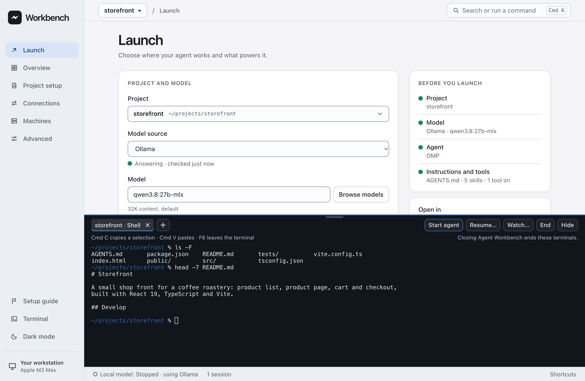
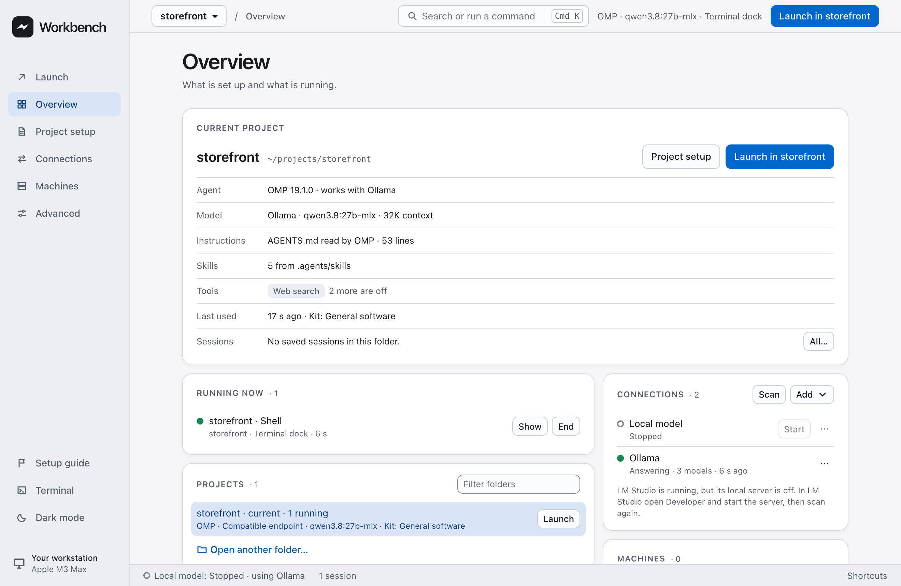

# Sessions and terminals

This guide covers where an agent runs once you launch it: the terminal dock inside the window, a terminal window of your system, sessions on an SSH machine and in the Docker sandbox, how to see what is running, how to resume earlier sessions, and the run summary of each launch.

The terminal dock, agent windows, resuming and the sandbox were not run for 0.4.0 in the finished desktop window; see [Tested configurations](../README.md#tested-configurations). The steps below carry that status.

## Two ways to run an agent

**Open in** on **Launch**, and on the setup guide's Ready step, offers two places:

- **Terminal dock**: a terminal inside the Agent Workbench window, with tabs. The dock keeps its sessions per project folder.
- **New terminal window**: a window of your system's own terminal. On macOS that is Terminal; macOS asks once for permission to let Agent Workbench control Terminal. On Windows it is a new console window. On Linux it is the first of `x-terminal-emulator`, `gnome-terminal`, `konsole` and `xterm` that is installed.

What closing Agent Workbench ends:

| What | When Workbench closes |
| --- | --- |
| Local terminals in the dock (shells and agents) | They end. Workbench closes them before it exits; this was not checked in a full desktop run for 0.4.0 |
| Remote sessions shown in the dock | The dock detaches from them; the tmux session keeps running on the machine |
| Agents in their own terminal windows | They keep running. Close the window to end one |
| The local model server | It keeps running. Stop it with **Stop** in the status bar or `workbench stop` |

## The terminal dock

These steps were not run for 0.4.0.

<picture>
<source media="(prefers-color-scheme: dark)" srcset="images/terminal-dark.png">

</picture>

Open the dock with **Terminal** in the sidebar, or with Ctrl+J (Cmd+J on macOS). Its buttons:

- **New shell**: a shell of your system in the project folder.
- **Start agent**: the agent with the current choices on **Launch**. While something is missing, it takes you to **Launch** and the first fix under **Before you launch** instead.
- **Resume…**: pick a saved session to continue (see [below](#recent-sessions-and-resume)).
- **Watch…**: follow a saved OMP session read-only.
- **End**: end the current session after you confirm. For a remote session it detaches instead.
- **Hide**: hide the dock. Sessions keep running.

While a local terminal is running, the dock shows "Closing Agent Workbench ends these terminals." Drag the top edge to resize the dock, or focus it and use the arrow keys.

Keys inside the dock:

| Action | Windows and Linux | macOS |
| --- | --- | --- |
| Copy the selection | Ctrl+C (with text selected; otherwise Ctrl+C goes to the program) | Cmd+C |
| Paste | Ctrl+Shift+V | Cmd+V |
| Leave the terminal for the next part of the window | F6 (Shift+F6 for the previous one) | F6 (Shift+F6 for the previous one) |
| Hide the dock | Ctrl+Shift+J | Cmd+J |

On Windows and Linux every other Ctrl key goes to the shell. **Shortcuts** in the status bar lists all keys.

If the Workbench service behind the window restarts, the dock marks its terminals "This terminal was closed because the Workbench service restarted." Start them again.

## Running sessions

Workbench keeps one list of everything it started that is still running:

- terminals in the dock;
- agents in their own terminal windows;
- remote tmux sessions on your SSH machines;
- the local model server;
- SSH tunnels to your machines.

<picture>
<source media="(prefers-color-scheme: dark)" srcset="images/overview-dark.png">

</picture>

**Overview** shows it under **Running now**, with **Show** and **End** for dock sessions, **Check** and **End** for remote sessions, and "Close its window to end it." for agents in their own windows. **Ended recently** lists sessions that exited, with **Launch again**. The sessions item in the status bar at the bottom of the window shows the same list from any page. `workbench sessions` prints it in a terminal.

## Recent sessions and resume

These steps were not run for 0.4.0.

Workbench reads each agent's own session history to list recent sessions for a folder. It reads only the start of each session file, where the agent records the folder and title; for opencode it reads the session list in opencode's database.

| Agent | Where its sessions are read from | What resuming runs |
| --- | --- | --- |
| OMP | `~/.omp/agent/sessions`, and the OMP profiles Workbench creates under `~/.omp/profiles` | `omp --resume <session file>` |
| Pi | `~/.pi/agent/sessions`, and the Pi settings folders Workbench creates | `pi --session <session file>` |
| Claude Code | `~/.claude/projects`, and the Claude Code settings folders Workbench creates | `claude --resume <session ID>` |
| Codex | `~/.codex/sessions`, and the Codex settings folders Workbench creates | `codex resume <session ID>` |
| opencode | `~/.local/share/opencode/opencode.db` | `opencode --session <session ID>` |
| Hermes | Not listed | Start Hermes with `hermes --continue` to continue its last session |

**Launch** lists the three newest sessions of the folder under **Recent sessions here**, with **All sessions…** for the rest. **Resume…** in the dock and **All…** on **Overview** open the same list, which you can filter by agent.

A session stays with the account it was started with. A session started with the agent's own sign-in must be resumed with **Agent account** as the source, and a session started with a Workbench source must be resumed with that source. When they do not match, the list says so ("This session used Claude Code's own account.") and offers a button that switches the source and resumes. For a session from the agent's own account, **Copy the resume command** copies the command to run it in your own terminal.

**Watch read-only** follows a saved OMP session as it grows, messages and tool calls included, also when the session runs in its own terminal window. Watching is available for OMP sessions only.

## Run summaries

Coming in the next release; the 0.4.0 kits do not have it.

Each time you start an agent from the Workbench window, in the terminal dock or in its own terminal window, Workbench records the launch as a run. The runs of a folder are kept in one plain JSON file in the `runs` folder of the data folder, newest first, up to 100 per folder ([Security and your data](security-and-data.md#where-workbench-keeps-data)). A run answers "what exactly ran here?" after the folder's setup has changed. It holds:

| Part | What it records |
| --- | --- |
| Agent | The agent and its version |
| Model source | The kind of source and the connection's name, not its address or key |
| Model | The model, the context size, the reasoning setting and, for a local model, the name of the weights file |
| Profile and kit | The profile and the starter kit in use, when there were any |
| MCP servers | The servers the agent received at launch |
| Instruction files | Each instruction file in the project the agent reads, with a hash of its contents. With your agent account, the agent can also read personal instruction files in your home folder; those are not listed |
| Skills | The skills the agent reads |
| Folder prompt | The prompt for this folder, when one is set |

A run never holds a key: no API keys, tokens or environment values, and no user name, password or query string from an address.

Where to find runs:

- Run summary on a terminal tab shows the run that tab started.
- Recent runs lists earlier launches in the folder.

What you can do with a run:

- Copy summary copies a Markdown summary, ready to paste into an issue, a pull request or your notes.
- Copy as JSON copies the same record as JSON.
- See what changed since that run: Workbench compares the run's instruction files and skills with the folder as it is now and lists each one that changed, is new or is gone.
- Save as profile turns the run into a named profile. Applying it goes through the usual review: **Apply profile** lists every setting it would change, and nothing changes until you confirm.

Runs stay on this computer and do not travel with the folder. Remove one run with Remove in Recent runs, or all runs of the folder with Clear runs. Sessions on an SSH machine and agents started with the `workbench` command are not recorded.

## Remote sessions

These steps were not run for 0.4.0.

On **Machines**, choose a machine and use **New remote session**:

- **Folder**: a folder on that machine; leave it empty for your home folder there.
- **Agent**: the agent to start there. It must be installed on the machine.
- **Mode**: "Use the remote CLI account" starts the agent with its own sign-in on the machine; "Project shell" opens a shell; "Use the managed model with OMP" starts OMP against the Workbench-managed model on the machine, starting the model first; "Sign in on the remote machine" runs the agent's sign-in there.

Then choose one of:

- **Open in terminal dock · tmux**: runs the session in tmux on the machine and shows it in the dock. The machine needs tmux, and you need a project folder selected here, because the dock keeps sessions per folder. Opening the same machine, folder, agent and mode again from the same project reattaches to the running session instead of starting a new one.
- **Open SSH terminal**: opens a plain SSH session in a terminal window of your system.

**End** in the dock detaches from a remote session and leaves it running. To end it on the machine, type `exit` in it, or use **End…** under **Remote sessions** on **Machines** or **End** on **Overview**. **Refresh** and **Check** read the machine's list again.

## From the command line

`workbench sessions` lists running sessions; with `--workspace <folder>` it also lists that folder's recent sessions with the command to resume each one, and `--json` prints both as JSON.

`workbench agent --workspace <folder>` starts the agent of your saved choices in a new terminal window, and `--here` runs it in the terminal you typed the command in. On Linux without a graphical session, use `--here`. [Reference](reference.md#command-line) lists every verb.

## Trace

These steps were not run for 0.4.0.

**Advanced → Trace** runs OMP on one task in the folder chosen on **Launch** and records each step: the tools it calls, their results and its answer. With **Allow file edits** off, OMP can read and search the folder but not change it. **Run trace** starts it and **Cancel trace** stops it. Traces are kept in the `traces` folder of the data folder and can contain your project's content.

## Isolated workspaces

These steps were not run for 0.4.0.

**Advanced → Sandbox** runs OMP inside a Docker container instead of on your computer:

1. Install Docker if Doctor reports it missing.
2. Choose **Local model** as the source on **Launch**; the sandbox talks to the local model on this computer.
3. Enter a name under **Docker workspace** (1 to 36 lowercase letters, digits or dashes) and choose **Open sandbox**. The first run builds the image, which can take up to 30 minutes. A terminal window opens with OMP in `/workspace`.

What the sandbox is:

- One container per name, `workbench-box-<name>`, built from `sandbox/Dockerfile` with OMP and Pi installed. OMP runs as the non-root user `node`.
- Its files live in a Docker volume, `workbench-box-<name>-work`, mounted at `/workspace`. Your project folders, your home folder and the Docker socket are not mounted. Clone or create projects inside `/workspace`.
- The container runs with `no-new-privileges`, at most 256 processes and 3 GB of memory. It can reach the network.
- It reaches the local model through an SSH reverse tunnel. The container's SSH port is published on `127.0.0.1` only, with a key made for that sandbox and its host key pinned.

**Stop sandbox** stops the container and keeps its files. To delete a sandbox and its files, remove the container and its volume with Docker ([Troubleshooting](troubleshooting.md#uninstall) lists the names).

If you want agents working on one repository in separate git worktrees, with diff review, tools built for that fit better: [Emdash](https://github.com/generalaction/emdash), [T3 Code](https://github.com/pingdotgg/t3code) or [Claude Squad](https://github.com/smtg-ai/claude-squad). Workbench does not run agents in parallel or create worktrees.

Product names belong to their owners. Agent Workbench is not affiliated with or endorsed by them.
